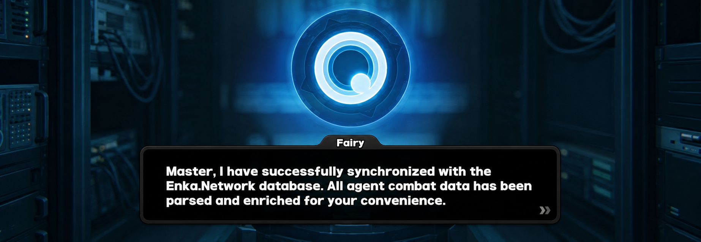

<div align="center">
  

  # Fairy

  **Fast, zero-overhead Go library for fetching and enriching Zenless Zone Zero player profiles.**

  [](https://github.com/kirinyoku/fairy/actions/workflows/ci.yml)
  [](https://zenless.hoyoverse.com)
  [](https://golang.org/doc/devel/release.html)
  [](https://pkg.go.dev/github.com/kirinyoku/fairy)
  [](https://opensource.org/licenses/MIT)

  *Fetch and enrich Zenless Zone Zero player profiles via the [EnkaNetwork API](https://enka.network) with localized names, calculated agent stats, and ready-to-use assets.*
</div>

---

### Key Features

- ⚡ **Zero-Overhead In-Memory**: Metadata is embedded into the binary. Transform raw data with **0 network calls** and **0 database queries**.
- 📊 **Combat Stats Breakdown**: Ready-to-render `Base` + `Added` = `Total` stat sheets matching the in-game UI.
- 💿 **Drive Disc & Build Scoring**: Set bonus tracking (2-pc/4-pc), roll aggregations, and build quality ratings based on in-game recommendations.
- 🌐 **13 Languages Embedded**: Instant localization for English, Russian, Japanese, Chinese, and more without external dependencies.
- 🎨 **Visual Assets & Rich Text**: Direct CDN URLs for agent splash art, discs, badges, and SVG icons, plus Unity Rich Text parsers for HTML/Markdown.

---

## Installation

Requires **Go 1.22+**

```bash
go get github.com/kirinyoku/fairy
```

---

## Quick Start

Fetch a player's showcase profile and inspect agents in under 15 lines of code:

```go
package main

import (
    "context"
    "fmt"
    "log"
    "time"

    "github.com/kirinyoku/fairy"
)

func main() {
    ctx, cancel := context.WithTimeout(context.Background(), 10*time.Second)
    defer cancel()

    profile, err := fairy.GetProfile(ctx, "1504687050")
    if err != nil {
        log.Fatal(err)
    }

    fmt.Printf("Player: %s (Lv.%d • %s)\n", profile.Nickname, profile.InterknotLevel, profile.Region)

    for _, agent := range profile.Agents {
        fmt.Printf("• %-16s Lv.%-2d [%s / %s]\n",
            agent.Name, agent.Level, agent.AttributeName, agent.SpecialtyName)
    }
}
```

```text
Player: LOWLEVEL (Lv.60 • Europe)
• Nangong Yu       Lv.60 [Ether / Stun]
• Yixuan           Lv.60 [Auric Ink / Rupture]
• Miyabi           Lv.60 [Frost / Anomaly]
```

---

## Common Recipes

### 1. In-Game Combat Stats (`Base` + `Added` = `Total`)

Fairy calculates final combat stats from agent base attributes, core skills, W-Engines, and Drive Discs:

```go
// agent.UIStats provides pre-formatted values matching the in-game attributes panel:
for _, stat := range agent.UIStats.List() {
    fmt.Printf("%-20s %8s (Base: %s + Added: %s)\n",
        stat.Name, stat.Total, stat.Base, stat.Added)
}

// Or access raw numeric values for damage calculators / simulations:
critRate := agent.Stats.CritRate // 0.05 (float64)
```

### 2. Drive Disc Analysis & Build Scoring

Inspect equipped discs, detect set bonuses, and count effective rolls against official in-game recommendations:

```go
// 1. Active Set Bonuses (2-pc and 4-pc)
for _, bonus := range agent.DriveDiscs.SetBonuses {
    fmt.Printf("Set: %s (%d-piece active)\n", bonus.Set.Name, bonus.Count)
}

// 2. Substat roll totals across all 6 discs
for _, stat := range agent.DriveDiscs.SubStatTotals() {
    fmt.Printf("• %-20s +%-6s (%d rolls)\n", stat.Name, stat.DisplayValue(), stat.Rolls)
}

// 3. Automated build rating (evaluates against official in-game recommended stats)
effectiveRolls := agent.CountEffectiveRolls()
fmt.Printf("Build Rating: %d effective substat rolls\n", effectiveRolls)
```

> [!NOTE]
> Recommendations are extracted directly from the official **Zenless Zone Zero** in-game recommendation system (the yellow highlight indicators in equipment and tuning screens).

### 3. Localization & Multi-Language Support

Fairy embeds translations for all **13 official languages** into the binary:

```go
// Fetch directly in another language:
profile, err := fairy.GetProfileWithLang(ctx, uid, fairy.LangRU)

// Or fetch raw API data once, and enrich into multiple languages in-memory (0 extra HTTP calls):
raw, _ := fairy.GetRawProfile(ctx, uid)
profileEN, _ := fairy.EnrichWithLang(raw, fairy.LangEN)
profileJA, _ := fairy.EnrichWithLang(raw, fairy.LangJA)
```

**Supported Languages:** `LangEN` (English), `LangRU` (Русский), `LangJA` (日本語), `LangZHCN` (简体中文), `LangZHTW` (繁體中文), `LangKO` (한국어), `LangDE` (Deutsch), `LangFR` (Français), `LangES` (Español), `LangPT` (Português), `LangID` (Bahasa Indonesia), `LangTH` (ไทย), `LangVI` (Tiếng Việt).

### 4. Skills, Mindscape & CDN Assets

Access skill groups, constellation upgrades, and direct asset links:

```go
// Skills grouped by the 6 in-game UI tabs (Basic, Special, Dodge, Chain, Assist, Passive)
for _, group := range agent.SkillGroups {
    fmt.Printf("[%s] Lv.%d\n", group.TypeName, group.Level)
}

// Mindscape Cinema (M0–M6)
fmt.Printf("Mindscape Cinema: M%d\n", agent.MindscapeCinema)

// High-resolution CDN assets
avatarURL := profile.Avatar.URL      // Player avatar
splashURL := agent.Skin.SplashArtURL // Full character splash art
discIcon  := disc.IconURL            // Drive Disc asset
```

### 5. Custom Client (Timeouts, Retries & Caching)

For production services, create a custom client with pluggable caching and custom timeouts:

```go
import "github.com/kirinyoku/enkanetwork-go/client/zzz"

client, err := fairy.NewClient(
    fairy.WithDefaultLang(fairy.LangEN),
    fairy.WithEnkaOptions(zzz.Options{
        UserAgent:  "MyZZZApp/1.0",
        HTTPClient: &http.Client{Timeout: 10 * time.Second},
        Retry:      &zzz.RetryOptions{MaxAttempts: 3, Delay: 1 * time.Second},
        // Cache: customCacheInstance, // Implements zzz.Cache
    }),
)

profile, err := client.GetProfile(ctx, "1504687050")
```

---

## API Overview

| Function | Description | Network |
| :--- | :--- | :---: |
| `fairy.GetProfile(ctx, uid)` | Fetch and enrich profile in default language | 🌐 HTTP |
| `fairy.GetProfileWithLang(ctx, uid, lang)` | Fetch and enrich profile in target language | 🌐 HTTP |
| `fairy.GetRawProfile(ctx, uid)` | Fetch unparsed profile from EnkaNetwork | 🌐 HTTP |
| `fairy.Enrich(raw)` | Enrich raw profile in-memory in default language | ⚡ In-memory |
| `fairy.EnrichWithLang(raw, lang)` | Enrich raw profile in-memory in target language | ⚡ In-memory |
| `fairy.EnrichAgent(raw)` | Enrich single agent in-memory in default language | ⚡ In-memory |
| `fairy.EnrichAgentWithLang(raw, lang)` | Enrich single agent in-memory in target language | ⚡ In-memory |
| `fairy.AgentRecommendedSubStats(id)` | Recommended Drive Disc substats for an agent | ⚡ In-memory |
| `fairy.AgentHighlightProps(id)` | Recommended profile combat property IDs for an agent | ⚡ In-memory |

📖 *For comprehensive godoc and struct reference, visit [pkg.go.dev/github.com/kirinyoku/fairy](https://pkg.go.dev/github.com/kirinyoku/fairy).*

---

## Error Handling

Fairy returns structured sentinel errors for clean checks with `errors.Is`:

```go
profile, err := fairy.GetProfile(ctx, uid)
if err != nil {
    switch {
    case errors.Is(err, fairy.ErrInvalidUID):
        // Malformed UID format
    case errors.Is(err, fairy.ErrProfileNotFound):
        // Player hidden or does not exist
    case errors.Is(err, fairy.ErrRateLimit):
        // Upstream rate limit reached
    case errors.Is(err, fairy.ErrMaintenance):
        // Game or API server maintenance
    case errors.Is(err, fairy.ErrNetwork):
        // Timeout or network failure
    }
}
```

---

## License

Released under the [MIT License](LICENSE).
